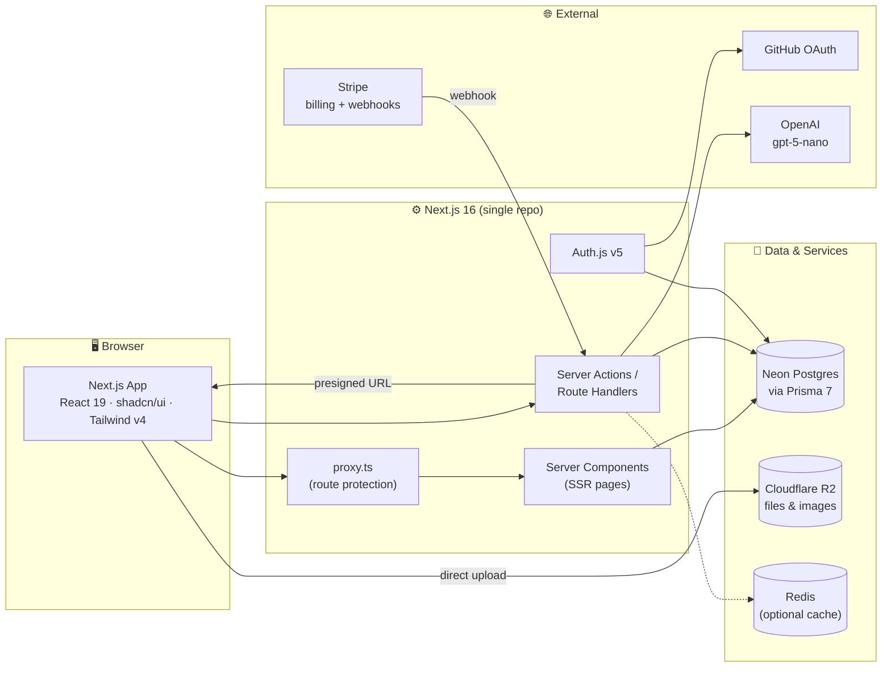
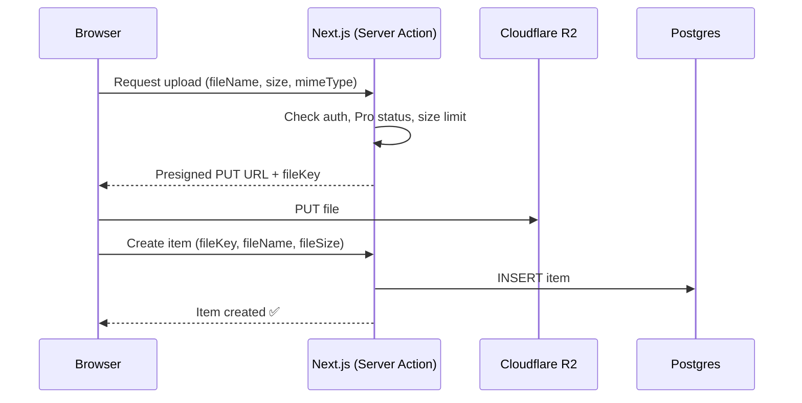
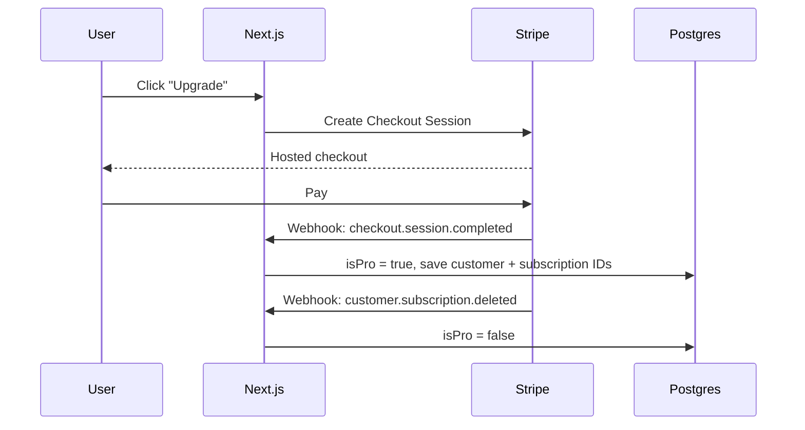
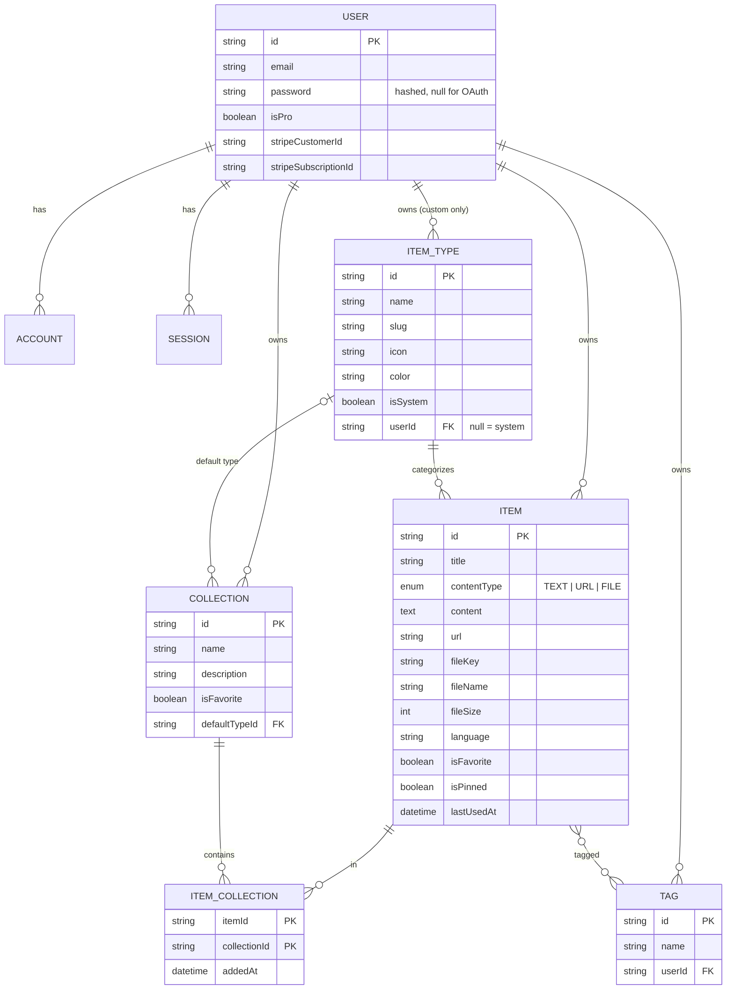

# 🗄️ DevVault — Project Overview

> **One fast, searchable, AI-enhanced hub for all developer knowledge and resources.**

| | |
|---|---|
| **Status** | Planning |
| **Model** | Freemium SaaS (Free / Pro) |
| **Stack** | Next.js 16 · React 19 · TypeScript · Prisma 7 · Neon Postgres · Auth.js v5 · Cloudflare R2 · Tailwind v4 · shadcn/ui · OpenAI |

---

## Table of Contents

1. [Problem](#1-problem)
2. [Target Users](#2-target-users)
3. [Features](#3-features)
4. [Item Types](#4-item-types)
5. [Architecture](#5-architecture)
6. [Data Model](#6-data-model)
7. [Prisma Schema](#7-prisma-schema)
8. [Tech Stack](#8-tech-stack)
9. [Monetization](#9-monetization)
10. [UI / UX](#10-ui--ux)
11. [Routes & Project Structure](#11-routes--project-structure)
12. [Roadmap](#12-roadmap)
13. [Review Notes & Open Questions](#13-review-notes--open-questions)
14. [Reference Links](#14-reference-links)

---

## 1. Problem

Developers keep their essentials scattered:

| What | Where it usually lives |
|---|---|
| Code snippets | VS Code, Notion |
| AI prompts | Chat histories |
| Context files | Buried in project folders |
| Useful links | Browser bookmarks |
| Docs | Random folders |
| Commands | `.txt` files, bash history |
| Project templates | GitHub Gists |

This causes **context switching**, **lost knowledge**, and **inconsistent workflows**.

**DevVault** gives developers one place to save, find, and reuse all of it, with fast search and optional AI help.

---

## 2. Target Users

| Persona | Primary need |
|---|---|
| 🧑‍💻 **Everyday Developer** | Grab snippets, prompts, commands, and links fast |
| 🤖 **AI-first Developer** | Store prompts, context files, workflows, system messages |
| 🎓 **Content Creator / Educator** | Store code blocks, explanations, course notes |
| 🏗️ **Full-stack Builder** | Collect patterns, boilerplates, API examples |

---

## 3. Features

### A. Items

- Every item has a **type** (see [Item Types](#4-item-types)).
- 7 **system types** ship at launch and cannot be edited or deleted.
- **Custom types** are a Pro feature planned for a later phase.
- Items open and are created in a **quick-access drawer**, never a full page reload.

### B. Collections

- A collection can hold items of **any type**.
- An item can belong to **multiple collections** (many-to-many).
  - e.g. a React snippet in both *React Patterns* and *Interview Prep*.
- Users can see which collections an item belongs to and add/remove it from several at once.

Examples:

| Collection | Typical contents |
|---|---|
| React Patterns | snippets, notes |
| Context Files | files |
| Python Snippets | snippets |

### C. Search

Search across **titles**, **content**, **tags**, and **types**.

### D. Authentication

- Email + password
- GitHub OAuth

### E. General Features

- ⭐ Favorite items and collections
- 📌 Pin items to the top
- 🕒 Recently used items
- 📥 Import code from a file
- ✍️ Markdown editor for text types
- 📎 File upload for file/image types *(Pro)*
- 📤 Export data as JSON / ZIP *(Pro)*
- 🌙 Dark mode by default, light mode optional

### F. AI Features *(Pro only)*

| Feature | Description |
|---|---|
| 🏷️ Auto-tag suggestions | Suggest tags from title + content |
| 📝 Summaries | Short summary of long notes/files |
| 💡 Explain This Code | Plain-language explanation of a snippet |
| ⚡ Prompt Optimizer | Rewrite a prompt to be clearer and more effective |

---

## 4. Item Types

Icons are from [Lucide](https://lucide.dev/icons) (bundled with shadcn/ui).

| Type | Slug / Route | Content kind | Icon (Lucide) | Color | Plan |
|---|---|---|---|---|---|
| Snippet | `/items/snippets` | `TEXT` | `Code` |  `#3b82f6` blue | Free |
| Prompt | `/items/prompts` | `TEXT` | `Sparkles` |  `#8b5cf6` purple | Free |
| Command | `/items/commands` | `TEXT` | `Terminal` |  `#f97316` orange | Free |
| Note | `/items/notes` | `TEXT` | `StickyNote` |  `#fde047` yellow | Free |
| Link | `/items/links` | `URL` | `Link` |  `#10b981` emerald | Free |
| File | `/items/files` | `FILE` | `File` |  `#6b7280` gray | **Pro** |
| Image | `/items/images` | `FILE` | `Image` |  `#ec4899` pink | **Pro** |

Seed data as a constant:

```ts
// src/lib/constants/item-types.ts
export const SYSTEM_ITEM_TYPES = [
  { slug: "snippets", name: "Snippet", icon: "Code",       color: "#3b82f6", contentType: "TEXT", proOnly: false },
  { slug: "prompts",  name: "Prompt",  icon: "Sparkles",   color: "#8b5cf6", contentType: "TEXT", proOnly: false },
  { slug: "commands", name: "Command", icon: "Terminal",   color: "#f97316", contentType: "TEXT", proOnly: false },
  { slug: "notes",    name: "Note",    icon: "StickyNote", color: "#fde047", contentType: "TEXT", proOnly: false },
  { slug: "links",    name: "Link",    icon: "Link",       color: "#10b981", contentType: "URL",  proOnly: false },
  { slug: "files",    name: "File",    icon: "File",       color: "#6b7280", contentType: "FILE", proOnly: true  },
  { slug: "images",   name: "Image",   icon: "Image",      color: "#ec4899", contentType: "FILE", proOnly: true  },
] as const;
```

---

## 5. Architecture



### File upload flow

Uploading straight from the browser to R2 keeps large files off your server.



### Pro upgrade flow



---

## 6. Data Model



---

## 7. Prisma Schema

> Written for **Prisma 7** (`prisma-client` generator, connection URL in `prisma.config.ts`, driver adapter for Neon). Double-check against the [latest Prisma docs](https://www.prisma.io/docs) before the first migration.

### `prisma/schema.prisma`

```prisma
generator client {
  provider = "prisma-client"
  output   = "../src/generated/prisma"
}

datasource db {
  provider = "postgresql"
}

// ─────────────────────────────────────────────
// Enums
// ─────────────────────────────────────────────

enum ContentType {
  TEXT // snippet, prompt, note, command
  URL  // link
  FILE // file, image
}

// ─────────────────────────────────────────────
// Auth (Auth.js v5 Prisma adapter models)
// ─────────────────────────────────────────────

model User {
  id                   String    @id @default(cuid())
  name                 String?
  email                String    @unique
  emailVerified        DateTime?
  image                String?
  password             String? // bcrypt/argon2 hash, null for OAuth-only users

  // Billing
  isPro                Boolean   @default(false)
  stripeCustomerId     String?   @unique
  stripeSubscriptionId String?   @unique

  createdAt            DateTime  @default(now())
  updatedAt            DateTime  @updatedAt

  accounts             Account[]
  sessions             Session[]
  items                Item[]
  itemTypes            ItemType[]
  collections          Collection[]
  tags                 Tag[]
}

model Account {
  id                String  @id @default(cuid())
  userId            String
  type              String
  provider          String
  providerAccountId String
  refresh_token     String? @db.Text
  access_token      String? @db.Text
  expires_at        Int?
  token_type        String?
  scope             String?
  id_token          String? @db.Text
  session_state     String?

  user User @relation(fields: [userId], references: [id], onDelete: Cascade)

  @@unique([provider, providerAccountId])
  @@index([userId])
}

model Session {
  id           String   @id @default(cuid())
  sessionToken String   @unique
  userId       String
  expires      DateTime

  user User @relation(fields: [userId], references: [id], onDelete: Cascade)

  @@index([userId])
}

model VerificationToken {
  identifier String
  token      String
  expires    DateTime

  @@unique([identifier, token])
}

// ─────────────────────────────────────────────
// Core domain
// ─────────────────────────────────────────────

model Item {
  id          String      @id @default(cuid())
  title       String
  description String?
  contentType ContentType

  // TEXT
  content     String?     @db.Text
  language    String? // e.g. "typescript", for syntax highlighting

  // URL
  url         String?

  // FILE (store the R2 object key, not a public URL)
  fileKey     String?
  fileName    String?
  fileSize    Int? // bytes
  mimeType    String?

  isFavorite  Boolean     @default(false)
  isPinned    Boolean     @default(false)
  lastUsedAt  DateTime? // powers "Recently used"

  createdAt   DateTime    @default(now())
  updatedAt   DateTime    @updatedAt

  userId      String
  user        User        @relation(fields: [userId], references: [id], onDelete: Cascade)

  typeId      String
  type        ItemType    @relation(fields: [typeId], references: [id], onDelete: Restrict)

  tags        Tag[]
  collections ItemCollection[]

  @@index([userId, typeId])
  @@index([userId, isPinned])
  @@index([userId, isFavorite])
  @@index([userId, lastUsedAt])
}

model ItemType {
  id       String  @id @default(cuid())
  name     String
  slug     String // used in routes: /items/[slug]
  icon     String // Lucide icon name
  color    String // hex
  isSystem Boolean @default(false)

  userId   String? // null = system type
  user     User?   @relation(fields: [userId], references: [id], onDelete: Cascade)

  items               Item[]
  defaultForCollections Collection[] @relation("CollectionDefaultType")

  @@unique([userId, slug])
  @@index([userId])
}

model Collection {
  id          String   @id @default(cuid())
  name        String
  description String?
  isFavorite  Boolean  @default(false)

  defaultTypeId String?
  defaultType   ItemType? @relation("CollectionDefaultType", fields: [defaultTypeId], references: [id], onDelete: SetNull)

  createdAt   DateTime @default(now())
  updatedAt   DateTime @updatedAt

  userId      String
  user        User     @relation(fields: [userId], references: [id], onDelete: Cascade)

  items       ItemCollection[]

  @@unique([userId, name])
  @@index([userId])
}

model ItemCollection {
  itemId       String
  collectionId String
  addedAt      DateTime @default(now())

  item       Item       @relation(fields: [itemId], references: [id], onDelete: Cascade)
  collection Collection @relation(fields: [collectionId], references: [id], onDelete: Cascade)

  @@id([itemId, collectionId])
  @@index([collectionId])
}

model Tag {
  id     String @id @default(cuid())
  name   String

  userId String
  user   User   @relation(fields: [userId], references: [id], onDelete: Cascade)

  items  Item[]

  @@unique([userId, name])
}
```

> ⚠️ **Postgres NULL gotcha:** `@@unique([userId, slug])` won't stop duplicate *system* slugs, because `NULL ≠ NULL`. Add a partial index by hand in the first migration:
>
> ```sql
> CREATE UNIQUE INDEX "ItemType_system_slug_key" ON "ItemType"("slug") WHERE "userId" IS NULL;
> ```

### `prisma.config.ts`

```ts
import "dotenv/config";
import { defineConfig, env } from "prisma/config";

export default defineConfig({
  schema: "prisma/schema.prisma",
  migrations: {
    path: "prisma/migrations",
    seed: "tsx prisma/seed.ts",
  },
  datasource: {
    url: env("DATABASE_URL"),
  },
});
```

### `src/lib/db.ts` — Prisma client singleton

```ts
import { PrismaClient } from "@/generated/prisma/client";
import { PrismaNeon } from "@prisma/adapter-neon";

const globalForPrisma = globalThis as unknown as { prisma?: PrismaClient };

const adapter = new PrismaNeon({ connectionString: process.env.DATABASE_URL! });

export const db = globalForPrisma.prisma ?? new PrismaClient({ adapter });

if (process.env.NODE_ENV !== "production") globalForPrisma.prisma = db;
```

### 🚨 Migration rules

> **NEVER use `prisma db push` or change the database structure directly.**

| Environment | Command |
|---|---|
| Development | `npx prisma migrate dev --name <descriptive_name>` |
| Production | `npx prisma migrate deploy` (run in CI/CD) |
| Seed system types | `npx prisma db seed` |

---

## 8. Tech Stack

| Layer | Choice | Notes |
|---|---|---|
| Framework | **Next.js 16** + **React 19** | App Router, SSR pages, dynamic client components, one repo |
| Language | **TypeScript** | Strict mode |
| Database | **Neon** (serverless Postgres) | Separate branches for dev / prod |
| ORM | **Prisma 7** | Migrations only, Neon driver adapter |
| Cache | **Redis** *(maybe)* | Defer until there's a measured need |
| File storage | **Cloudflare R2** | S3-compatible API, presigned uploads, no egress fees |
| Auth | **Auth.js (NextAuth) v5** | Credentials (email/password) + GitHub OAuth |
| AI | **OpenAI `gpt-5-nano`** | Pro only, server-side calls only |
| Payments | **Stripe** | Checkout + Customer Portal + webhooks |
| Styling | **Tailwind CSS v4** + **shadcn/ui** | Lucide icons |
| Syntax highlighting | e.g. **Shiki** | Server-rendered highlighting |
| Markdown editor | TBD | e.g. CodeMirror 6 / Monaco for code, a Markdown editor for notes |

### Environment variables

```bash
# Database
DATABASE_URL=

# Auth.js
AUTH_SECRET=
AUTH_GITHUB_ID=
AUTH_GITHUB_SECRET=

# Cloudflare R2
R2_ACCOUNT_ID=
R2_ACCESS_KEY_ID=
R2_SECRET_ACCESS_KEY=
R2_BUCKET_NAME=

# OpenAI
OPENAI_API_KEY=

# Stripe
STRIPE_SECRET_KEY=
STRIPE_WEBHOOK_SECRET=
STRIPE_PRICE_MONTHLY=
STRIPE_PRICE_YEARLY=

# Feature flags
ENFORCE_PRO_LIMITS=false   # false during development: everyone gets Pro features
```

---

## 9. Monetization

Freemium model.

| Feature | 🆓 Free | 💎 Pro |
|---|---|---|
| **Price** | $0 | **$8/month** or **$72/year** (25% off) |
| Items | 50 total | Unlimited |
| Collections | 3 | Unlimited |
| System types | All except File & Image | All |
| Search | Basic | Full |
| File & image uploads | ❌ | ✅ |
| Custom types | ❌ | ✅ *(later phase)* |
| AI auto-tagging | ❌ | ✅ |
| AI summaries | ❌ | ✅ |
| AI Explain This Code | ❌ | ✅ |
| AI prompt optimizer | ❌ | ✅ |
| Export (JSON / ZIP) | ❌ | ✅ |
| Priority support | ❌ | ✅ |

### Gating foundation

Build the checks now, but keep them switched off during development so every user can access everything.

```ts
// src/lib/plans.ts
export const FREE_LIMITS = {
  items: 50,
  collections: 3,
} as const;

const ENFORCE = process.env.ENFORCE_PRO_LIMITS === "true";

export function hasPro(user: { isPro: boolean }) {
  return !ENFORCE || user.isPro;
}

export function canCreateItem(user: { isPro: boolean }, currentCount: number) {
  return hasPro(user) || currentCount < FREE_LIMITS.items;
}

export function canCreateCollection(user: { isPro: boolean }, currentCount: number) {
  return hasPro(user) || currentCount < FREE_LIMITS.collections;
}
```

Always enforce these checks **on the server** (Server Actions / Route Handlers). UI checks are only for showing upgrade prompts.

---

## 10. UI / UX

### Principles

- Modern, minimal, developer-focused
- **Dark mode by default**, light mode optional
- Clean typography, generous whitespace
- Subtle borders and shadows
- Syntax highlighting for all code blocks
- Inspiration: [Notion](https://www.notion.so), [Linear](https://linear.app), [Raycast](https://www.raycast.com)

### Screenshots

Refer to the screenshots below as a base for the Dashboard UI.
It does not to be exact, use it as a reference:
- @context/screenshots/dashboard-main-ui.png
- @context/screenshots/dashboard-ui-drawer.png
- @context/screenshots/dashboard-add-new-item.png


### Layout

```
┌──────────────────────────────────────────────────────────────┐
│  🔍 Search (⌘K)                                  [+ New] 👤  │
├───────────────┬──────────────────────────────────────────────┤
│ ☰ SIDEBAR     │  MAIN                                        │
│               │                                              │
│ Types         │  Collections                                 │
│  </> Snippets │  ┌──────────┐ ┌──────────┐ ┌──────────┐      │
│  ✨ Prompts   │  │ React    │ │ Context  │ │ Python   │      │
│  >_ Commands  │  │ Patterns │ │ Files    │ │ Snippets │      │
│  🗒 Notes     │  │ (blue bg)│ │ (gray bg)│ │ (blue bg)│      │
│  🔗 Links     │  └──────────┘ └──────────┘ └──────────┘      │
│  📄 Files     │                                              │
│  🖼 Images    │  Pinned / Recent items                       │
│               │  ┌─────────┐ ┌─────────┐ ┌─────────┐         │
│ Collections   │  │▌useFetch│ │▌Refactor│ │▌git undo│         │
│  ⭐ React...  │  │ (blue   │ │ (purple │ │ (orange │         │
│  • Python...  │  │ border) │ │ border) │ │ border) │         │
│  • Context... │  └─────────┘ └─────────┘ └─────────┘         │
└───────────────┴──────────────────────────────────────────────┘
                   Clicking an item → slides open a drawer ▶
```

- **Sidebar** (collapsible): item types linking to `/items/[slug]`, plus latest/favorite collections.
- **Main**: grid of collection cards. Each card's **background color** comes from the item type it holds the most of.
- **Items**: cards with a **border color** matching their type.
- **Item detail/edit**: opens in a drawer (shadcn `Sheet`) for fast access.

### Responsive

- Desktop-first, fully usable on mobile.
- Sidebar becomes a drawer on mobile.

### Micro-interactions

- Smooth transitions
- Hover states on cards
- Toasts for actions (shadcn `Sonner`)
- Loading skeletons (shadcn `Skeleton`)
- Suggested: ⌘K command palette (shadcn `Command`) for search and quick create

---

## 11. Routes & Project Structure

### Routes

| Route | Purpose |
|---|---|
| `/` | Marketing / landing page |
| `/sign-in`, `/sign-up` | Auth |
| `/dashboard` | Collections grid + pinned/recent items |
| `/items/[slug]` | All items of a type, e.g. `/items/snippets` |
| `/collections` | All collections |
| `/collections/[id]` | Items in a collection |
| `/settings` | Profile, billing, export |
| `/api/auth/[...nextauth]` | Auth.js handlers |
| `/api/webhooks/stripe` | Stripe webhook |

### Suggested structure

```
devvault/
├── prisma/
│   ├── schema.prisma
│   ├── migrations/
│   └── seed.ts                 # seeds system item types
├── prisma.config.ts
├── src/
│   ├── app/
│   │   ├── (marketing)/page.tsx
│   │   ├── (auth)/sign-in/  sign-up/
│   │   ├── (app)/
│   │   │   ├── layout.tsx      # sidebar + header
│   │   │   ├── dashboard/
│   │   │   ├── items/[slug]/
│   │   │   ├── collections/[id]/
│   │   │   └── settings/
│   │   └── api/
│   │       ├── auth/[...nextauth]/route.ts
│   │       └── webhooks/stripe/route.ts
│   ├── actions/                # Server Actions: items, collections, ai, upload
│   ├── components/
│   │   ├── ui/                 # shadcn
│   │   ├── items/
│   │   ├── collections/
│   │   └── layout/
│   ├── generated/prisma/       # Prisma client output (gitignored)
│   ├── lib/
│   │   ├── db.ts
│   │   ├── auth.ts
│   │   ├── r2.ts
│   │   ├── openai.ts
│   │   ├── stripe.ts
│   │   ├── plans.ts
│   │   └── constants/item-types.ts
│   └── proxy.ts                # route protection (formerly middleware.ts)
└── .env
```

---

## 12. Roadmap

| Phase | Scope |
|---|---|
| **1 — Foundation** | Next.js setup, Tailwind v4 + shadcn, Prisma + Neon, first migration, seed system types, Auth.js (email/password + GitHub) |
| **2 — Core CRUD** | Items (text + link types), drawer create/edit, Markdown editor, syntax highlighting, tags |
| **3 — Collections** | Collections CRUD, many-to-many assignment, color-coded cards, favorites, pinning, recently used |
| **4 — Search** | Postgres full-text search across title, content, tags, type; ⌘K palette |
| **5 — Files** | R2 presigned uploads, file/image items, import code from file |
| **6 — Billing** | Stripe checkout, webhooks, Customer Portal, plan limits (behind `ENFORCE_PRO_LIMITS`) |
| **7 — AI** | Auto-tags, summaries, Explain This Code, prompt optimizer |
| **8 — Export & polish** | JSON/ZIP export, light mode, mobile polish, skeletons, toasts |
| **Later** | Custom item types, Redis caching if needed |

---

## 13. Review Notes & Open Questions

Changes and fixes made while cleaning up the notes:

1. **`contentType` needed a third value.** The notes said `text | file`, but links are neither. Changed it to `TEXT | URL | FILE`.
2. **Store `fileKey`, not `fileUrl`.** Keep R2 objects private and serve them through short-lived signed URLs. This way, access control stays in your app, and you can change domains or buckets later without rewriting rows.
3. **Added `mimeType`** to items, for rendering image previews and validating uploads.
4. **Added `lastUsedAt`** to items. "Recently used" needs a timestamp that updates when an item is opened or copied, separate from `updatedAt`.
5. **Tags must be per user.** The original `TAG` had only `id` and `name`. Without a `userId`, users would share or collide on tags. Added `userId` + `@@unique([userId, name])` and an implicit many-to-many relation with items.
6. **Added `slug` to `ItemType`** so routes like `/items/snippets` map cleanly to a type.
7. **Auth.js needs extra tables and a password field.** Added `Account`, `Session`, `VerificationToken`, and a hashed `password` on `User`. Note that the Credentials provider requires the **JWT session strategy**; database sessions don't work with it.
8. **"AI Summaries"** appeared in the feature list but not in the Pro tier. Added it to Pro.
9. **Export** was listed under general features but is Pro-only. Marked it as Pro.
10. **Custom types**: the features section says users can create them, but pricing says "later." Treated as a later Pro phase; the schema already supports them via `userId` on `ItemType`.
11. **Collection card color** should be derived at query time (most common type among its items), not stored, so it never goes stale.
12. **Yellow notes (`#fde047`) have poor contrast** in light mode. Consider a darker shade (e.g. `#ca8a04`) for borders and text in light mode.
13. **Search**: start with Postgres full-text search (`tsvector` + GIN index), plus `pg_trgm` for fuzzy title matching. Neon supports both. That likely makes Redis unnecessary at launch.
14. **Typo fixed**: "GitHu gists" → GitHub Gists.

Open questions:

- ❓ What happens to a Pro user's files and extra items if they downgrade? (Read-only is a common approach.)
- ❓ Max file size per upload and total storage per Pro user?
- ❓ AI usage limits per Pro user (to control OpenAI cost)?
- ❓ Should tags be free-form or suggested from existing tags only?
- ❓ Email verification and password reset for email/password accounts (needs a transactional email provider)?

---

## 14. Reference Links

| Tool | Docs |
|---|---|
| Next.js | https://nextjs.org/docs |
| React | https://react.dev |
| Prisma | https://www.prisma.io/docs |
| Prisma + Neon | https://www.prisma.io/docs/orm/overview/databases/neon |
| Neon | https://neon.com/docs |
| Auth.js (NextAuth v5) | https://authjs.dev |
| Auth.js Prisma adapter | https://authjs.dev/getting-started/adapters/prisma |
| Cloudflare R2 | https://developers.cloudflare.com/r2 |
| Tailwind CSS v4 | https://tailwindcss.com/docs |
| shadcn/ui | https://ui.shadcn.com |
| Lucide icons | https://lucide.dev/icons |
| Shiki | https://shiki.style |
| Stripe Billing | https://docs.stripe.com/billing |
| OpenAI API | https://platform.openai.com/docs |
| Mermaid | https://mermaid.js.org |
